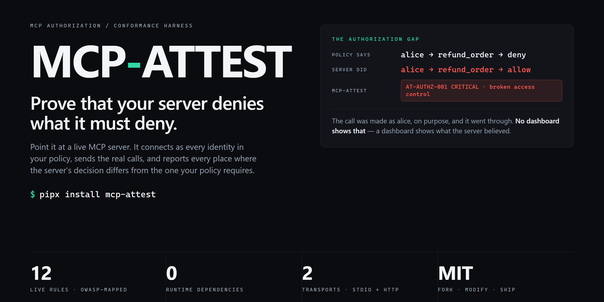
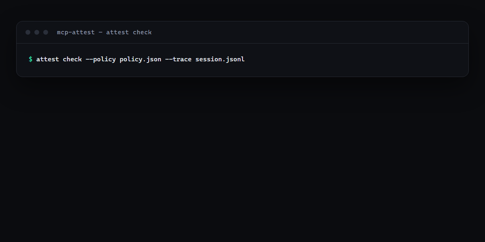
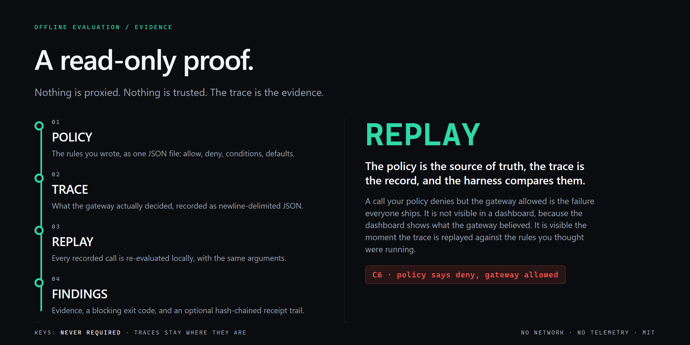

<div align="center">
  
  <p><strong>Prove that your MCP policy actually enforces.</strong></p>
  <p>Two input files · nine checks · zero runtime dependencies · MIT</p>
  <p>
    <a href="#install">Install</a> ·
    <a href="#run-it">Run it</a> ·
    <a href="#the-nine-checks">The nine checks</a> ·
    <a href="#use-it-in-ci">CI</a> ·
    <a href="SPEC.md">Specification</a> ·
    <a href="https://balanov.pro/mcp-attest/">Website</a> ·
    <a href="README_RU.md">Русский</a>
  </p>
  <p>
    <a href="https://github.com/Balanov/mcp-attest/actions/workflows/ci.yml"></a>
    <a href="https://github.com/Balanov/mcp-attest/releases/latest"></a>
    <a href="LICENSE"></a>
    <a href="https://pypi.org/project/mcp-attest/"></a>
    <a href="https://pypi.org/project/mcp-attest/"></a>
  </p>
</div>

<div align="center">
  
  <p><sub>Real output from <code>examples/session.jsonl</code>. Exit code 1 means a blocking finding. <a href="examples/">Examples</a> · <a href="docs/RESEARCH.md">Why this exists</a>.</sub>
</div>

`mcp-attest` is a conformance harness for MCP agent access control. It takes the policy you wrote and the trace of what actually happened, and reports every point where they disagree.

It is not a gateway. It does not sit on the request path, and it never holds a credential for the upstream server. It reads evidence that already exists.

## Why mcp-attest?

- **It catches the accepted-but-not-enforced rule.** C6 re-evaluates your policy locally against every recorded call. A call your policy denies but the gateway allowed is invisible in every dashboard, because dashboards show what the gateway believed.
- **Evidence, not opinion.** Every finding carries the exact tool, arguments and decision that produced it, and the fix.
- **Offline by construction.** No network calls, no telemetry, no account. Traces carry payloads and stay where they are.
- **Exit codes, not vibes.** `0` clean, `1` blocking finding, `2` bad input. It is a CI gate without a wrapper script.
- **Zero dependencies.** Python 3.10+ and the standard library.
- **Tamper-evident receipts.** Optional hash-chained, HMAC-signed receipts for every allowed call.

<div align="center">
  
  <p><sub>Nothing is proxied. The trace is the evidence. <a href="SPEC.md">Full specification</a>.</sub>
</div>

**[Website](https://balanov.pro/mcp-attest/) · [Specification](SPEC.md) · [Research notes](docs/RESEARCH.md) · [MIT license](LICENSE)**

## Install

```sh
pipx install mcp-attest          # isolated CLI
uvx mcp-attest check --help      # one-shot
pip install mcp-attest           # into a virtualenv
```

From source:

```sh
git clone https://github.com/Balanov/mcp-attest.git
cd mcp-attest
python -m pip install -e ".[dev]"
python -m unittest discover -s tests -v
```

## Run it

```sh
attest init                                            # write a starter policy
attest check --policy examples/policy.json --trace examples/session.jsonl
```

```text
!! [CRITICAL] C6 Policy denies 'shell__exec' but the gateway allowed it
          Local evaluation of the policy says deny (tool is on the deny list); the trace
          records allow ('argument-conditioned rule matched'). This is the 'policy accepted
          but not enforced' failure mode — a rule that is registered but never applied.
          fix: Replay the call against the gateway with the same arguments and fix
               the rule binding, then add this call as a regression case in CI.

summary: critical=7, high=6
```

Exit code `1` means a blocking finding exists. `--json` prints machine-readable findings; `--strict` treats high findings as blocking as well.

| Command | Purpose |
|---|---|
| `attest init` | Write a starter policy |
| `attest check` | Check a trace against a policy |
| `attest receipts` | Build and verify a hash-chained receipt trail |
| `attest shadow` | List the servers an agent can reach outside the gateway |
| `attest rules` | List the enforced rules |

## The nine checks

| ID | Rule | The failure it catches |
|---|---|---|
| C1 | default-deny | An unset allowlist silently meaning "allow everything" |
| C2 | list/call parity | A tool hidden from `tools/list` but callable by name |
| C3 | narrowing only | A per-request control widening a client's grant |
| C4 | credential separation | The client's token replayed upstream verbatim |
| C5 | fail closed | A call allowed because the policy check errored |
| C6 | enforcement parity | The policy says deny, the gateway allowed it |
| C7 | shadow MCP | A server the agent can reach outside the gateway |
| C8 | receipt chain | Allowed calls with no verifiable receipt, or a broken chain |
| C9 | description integrity | A tool definition changed after approval (rug pull) |

## Input files

### Policy

```json
{
  "version": 1,
  "default_decision": "deny",
  "clients": {
    "ci-bot": {
      "tools": {
        "allow": ["fs__read_file", "fs__list_directory"],
        "deny": ["fs__write_file", "fs__delete_everything"],
        "conditional": [
          {
            "tool": "fs__write_file",
            "allow_when": { "path": { "starts_with": "./out/" } },
            "action": "allow",
            "reason": "writes are allowed only inside ./out/"
          }
        ]
      },
      "egress_hosts": ["api.internal.example.com"]
    }
  },
  "gateway": { "mode": "routed", "fail_closed": true, "passthrough_credentials": false },
  "receipts": { "required": true, "key_env": "MCP_ATTEST_KEY" }
}
```

Condition operators: `eq`, `not_eq`, `starts_with`, `ends_with`, `contains`, `in`, `not_in`, `gt`, `gte`, `lt`, `lte`, `glob`, `regex`. A bare string ending in `/` is a prefix; a bare string containing `*` is a glob.

### Trace

Newline-delimited JSON, one event per line. Any proxy, agent harness or CI step can produce it.

```jsonl
{"type":"tools_list","actor":"ci-bot","tools":[{"name":"fs__read_file","description_sha256":"a1b2…"}]}
{"type":"tool_call","actor":"ci-bot","tool":"fs__read_file","args":{"path":"/srv/README.md"},"decision":"allow","upstream":true,"reason":"tool is on the allow list"}
{"type":"client_servers","client":"claude-code","servers":["fs","git"]}
{"type":"gateway_route","server":"fs","tools":["read_file","list_directory"]}
```

Full specification: [SPEC.md](SPEC.md).

## Receipts

```sh
export MCP_ATTEST_KEY=…
attest receipts --trace examples/session.jsonl --out receipts.jsonl
# chain: ok (6 receipts, key=yes)
```

Each receipt commits to the previous one, so removing or reordering a receipt breaks the chain. With `MCP_ATTEST_KEY` set, every receipt is additionally signed with HMAC-SHA256, so an auditor can detect edits without access to the gateway.

This is deliberately not a PKI. It answers the question an incident responder actually asks: *did this session really contain these calls, in this order, and has anything been altered since?*

## Use it in CI

```yaml
- uses: Balanov/mcp-attest@v0
  with:
    policy: .attest/policy.json
    trace: .attest/trace.jsonl
```

The action fails the job on any critical or high finding, so "our agent policy is enforced" becomes something the pipeline proves instead of something a security questionnaire asks about.

## What mcp-attest is not

- Not a gateway, proxy or enforcement point. It cannot block a call.
- Not a scanner. It does not connect to your MCP server and sends no probe traffic.
- Not a PKI. A receipt chain and an HMAC prove order and integrity, not identity.
- Not a policy editor. It reads the policy you already have.
- Not a hosted service. No account, no network calls, no telemetry.

## Development

```sh
python -m pip install -e ".[dev]"
python -m unittest discover -s tests -v
```

CI runs the suite on Python 3.10–3.13 and publishes the package to PyPI from a tagged release through trusted publishing, with no API token in the repository.

## License

[MIT](LICENSE). Fork it, modify it, embed it, ship it.
