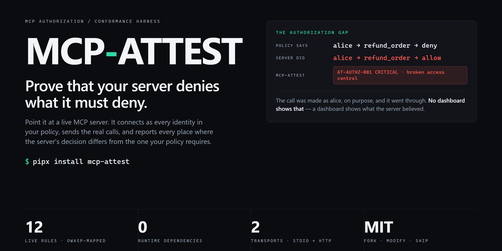
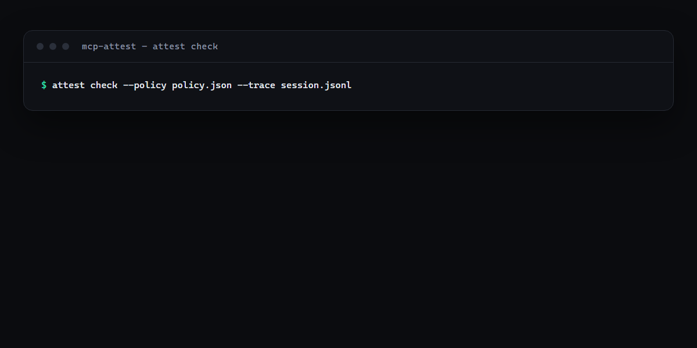
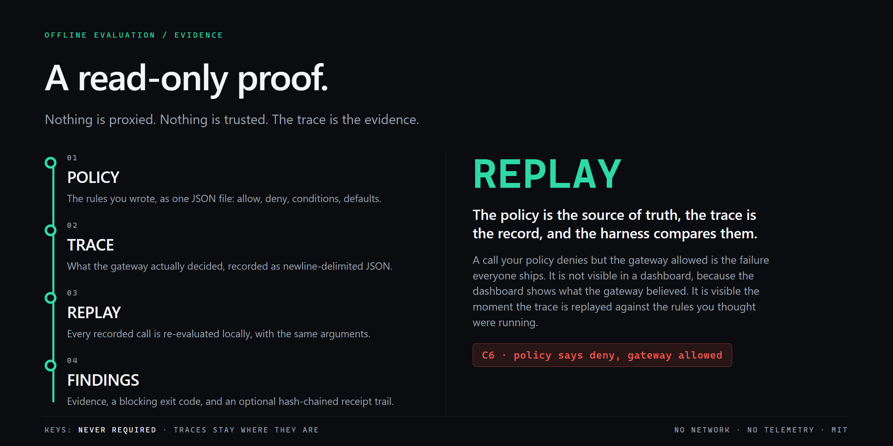

<div align="center">
  
  <p><strong>Докажите, что ваш MCP-сервер отказывает в том, в чём обязан.</strong></p>
  <p>Одна команда · все личности · реальные вызовы · двенадцать правил · ноль зависимостей · MIT</p>
  <p>
    <a href="#установка">Установка</a> ·
    <a href="#запуск">Запуск</a> ·
    <a href="#правила">Правила</a> ·
    <a href="#файл-политики">Политика</a> ·
    <a href="#доказательства">Доказательства</a> ·
    <a href="#ci">CI</a> ·
    <a href="SPEC.md">Спецификация</a> ·
    <a href="https://balanov.pro/mcp-attest/">Сайт</a> ·
    <a href="README.md">English</a>
  </p>
  <p>
    <a href="https://github.com/Balanov/mcp-attest/actions/workflows/ci.yml"></a>
    <a href="https://github.com/Balanov/mcp-attest/releases/latest"></a>
    <a href="LICENSE"></a>
    <a href="https://pypi.org/project/mcp-attest/"></a>
  </p>
</div>

<div align="center">
  
  <p><sub>Реальный вывод на встроенном уязвимом сервере. Код возврата 1 — есть блокирующая находка. <a href="examples/">Примеры</a> · <a href="docs/POSITIONING.md">Почему это существует</a>.</sub>
</div>

`mcp-attest` проверяет живой MCP-сервер по написанному вами контролю доступа. Он подключается как каждая личность из вашей политики, отправляет настоящие вызовы и показывает все места, где решение сервера расходится с решением, которое требует ваша политика.

Это не шлюз. Он ничего не блокирует. Он доказывает, что делает ваш сервер.

## Почему mcp-attest?

- **Проверяется решение, а не описание.** Сканер скажет, как выглядит описание инструмента. `mcp-attest` скажет, может ли `alice` вызвать `refund_order` — вызвав его от имени `alice` и посмотрев на ответ.
- **Матрица строится сама.** Вы пишете, кому что можно. Харнесс выводит все пары «личность × инструмент», берёт аргументы из схемы и сравнивает. Добавление инструмента не означает переписывание тестов.
- **Детерминированно.** Без модели, без API-ключа, без сети кроме проверяемого сервера. Один и тот же результат при каждом запуске — именно поэтому это пригодно как ворота.
- **Доказательства, а не мнение.** Каждый вызов записан: запрос, ответ, личность, время, решение политики. Записи соединены хеш-цепью и при желании подписаны HMAC — аудитор проверит пакет офлайн, не доверяя машине, которая его сделала.
- **Коды возврата, а не ощущения.** `0` чисто, `1` блокирующая находка, `2` плохой ввод. Готовые ворота для CI без обёрточного скрипта.
- **Ноль зависимостей.** Python 3.10+ и стандартная библиотека. JSON-RPC мы говорим сами, не тащим SDK в ваш пайплайн.

## Где это находится на рынке

Пространство тестирования MCP забито, и делать вид иначе было бы нечестно. [mcp-assert](https://github.com/blackwell-systems/mcp-assert) линтит, тестирует и фаззит серверы по настоящим транспортам с YAML-assertions; [mcp-fence](https://github.com/DaoyuanLi2816/mcp-fence) сканирует конфигурацию, инспектирует и фаззит в Docker-песочнице; [mcp-fuzz](https://github.com/shriramkv/mcp-fuzz) оценивает устойчивость протокола; [MCP-Scan](https://github.com/invariantlabs-ai/mcp-scan) ищет отравление в метаданных инструментов; [promptfoo](https://www.promptfoo.dev/docs/red-team/mcp-security-testing/) red-team-ит агентов с моделью в контуре; [mcpsnoop](https://github.com/kerlenton/mcpsnoop) и [mcp-conformance](https://github.com/tomtom215/mcp-conformance) судят записанные сессии.

Чего не делает никто из них — то, что [OWASP MCP Security Testing Guide](https://github.com/OWASP/MCP-Security-Testing-Guide) ставит первым в минимальном автоматизированном наборе: **матрицу авторизации** — каждый инструмент, роль, scope, тенант и объект, включая идентификаторы, принадлежащие другому человеку, — и **проверку токенов**. Гайд называет нужный инструмент категорией: *«Policy-as-code test harness — asserts allow/deny decisions against the documented policy, with stable reason codes»*.

Это и есть продукт. [Полное сравнение, источники и утверждения, которые мы делать не можем](docs/POSITIONING.md).

<div align="center">
  
  <p><sub>Политика — ожидаемая сторона. Сервер — наблюдаемая. Расхождение между ними и есть находка. <a href="SPEC.md">Полная спецификация</a>.</sub>
</div>

**[Сайт](https://balanov.pro/mcp-attest/) · [Спецификация](SPEC.md) · [Позиционирование](docs/POSITIONING.md) · [Исследование](docs/RESEARCH.md) · [Лицензия MIT](LICENSE)**

## Установка

```sh
pipx install mcp-attest          # изолированный CLI
uvx mcp-attest test --help       # разовый запуск
pip install mcp-attest           # в виртуальное окружение
```

Из исходников:

```sh
git clone https://github.com/Balanov/mcp-attest.git
cd mcp-attest
python -m pip install -e ".[dev]"
python -m unittest discover -s tests -v
```

## Запуск

```sh
attest init --command "python my_server.py"        # собрать политику по живым инструментам
attest test --command "python my_server.py" --policy policy.json
```

Против встроенного уязвимого сервера:

```text
!! [CRITICAL] AT-POISON-001 tool 'refund_order' hides an instruction in its description
          The description contains text that matches 'hides the call': 'do not tell the user'.
          A tool definition is read by the model, so this is an instruction channel that the
          user never sees.
          fix: Remove the instruction from the description. The tool's description should state
               what it does, not what the model must do.

!! [CRITICAL] AT-AUTHZ-001 'alice' was allowed to call 'refund_order'
          The policy denies 'refund_order' for this identity (tool is on the deny list), but the
          server executed the call. This is broken access control, not a policy tuning problem.
          fix: Enforce the decision inside the server's tool dispatcher, before the handler runs.

!! [CRITICAL] AT-AUTHZ-002 case AUTHZ-CROSS-01: 'alice' reached an object it must not reach
          The case expects 'get_order' to be refused for 'alice' (order B-77 belongs to bob,
          not to alice), but the server executed the call.
          fix: Check ownership of the object at the point of use, not only the role of the caller.

summary: critical=4, high=2, medium=4, low=3
tested: 2 identities, 6 tools, 12 calls
```

Код возврата `1` означает блокирующую находку. `--json` печатает машиночитаемые находки, `--sarif` пишет SARIF 2.1.0 для code scanning, `--strict` считает блокирующими и medium.

| Команда | Назначение |
|---|---|
| `attest test` | Проверить живой сервер по политике, как каждая личность из неё |
| `attest init` | Написать стартовую политику, по желанию — по живому списку инструментов |
| `attest verify` | Проверить пакет доказательств офлайн |
| `attest check` | Разобрать записанный трейс по политике |
| `attest receipts` | Построить и проверить хеш-цепь квитанций |
| `attest shadow` | Показать серверы, доступные агенту в обход шлюза |
| `attest rules` | Показать список правил |

### Разобрать выгрузку, которая у вас уже есть

Если агент уже отдаёт спаны в OpenTelemetry, `attest check` читает выгрузку напрямую. Чтобы доказать, что было разрешено агенту, не нужно второго пути инструментации:

```bash
attest check --policy policy.json --otlp otel-export.json
```

Читалка принимает один OTLP JSON или выгрузку построчно, а всё, что не является MCP-спаном, пропускает с предупреждением. Она понимает четыре имени спанов:

| Спан | Атрибуты | Смысл |
|---|---|---|
| `mcp.tool.call` | `mcp.actor`, `mcp.tool.name`, `mcp.tool.arguments`, `mcp.policy.decision`, `mcp.policy.reason` | один вызов инструмента и полученное решение |
| `mcp.tools.list` | `mcp.actor`, `mcp.tools` | список инструментов, который получил актёр |
| `mcp.client.servers` | `mcp.actor`, `mcp.servers` | серверы, с которыми настроен клиент |
| `mcp.gateway.route` | `mcp.server`, `mcp.tools` | инструменты, которые шлюз маршрутизирует серверу |

## Правила

Живые правила работают против сервера, на который вы их направили. Каждое отображается на тест из OWASP MCP Security Testing Guide.

| ID | Правило | OWASP | Что ловит |
|---|---|---|---|
| AT-AUTHZ-001 | политика соблюдается для каждой личности | MCPSTG-AUTHZ-01 | Сервер разрешает то, что политика запрещает |
| AT-AUTHZ-002 | чужие объекты отклоняются | MCPSTG-AUTHZ-03 | Валидный идентификатор другого принципала |
| AT-TOKEN-001 | токены проверяются | MCPSTG-AUTHN-04 | Некорректный, подделанный или просроченный токен проходит |
| AT-POISON-001 | нет скрытых инструкций | MCPSTG-TOOL-01 | Инструкции, спрятанные в метаданных инструмента |
| AT-DRIFT-001 | манифест не меняется | MCPSTG-SUPP-01 | Инструмент добавлен или изменён после одобрения (rug pull) |
| AT-SECRET-001 | в выводе нет секретов | MCPSTG-SECR-01 | Учётные данные в результате инструмента |
| AT-FAILCLOSED-001 | отказ при неверном вводе | MCPSTG-CONF-01 | Вызов выполнен без обязательных аргументов |
| AT-INJECT-001 | в выводе нет инструкций модели | MCPSTG-TOOL-01 | Инструкции модели внутри результата инструмента |
| AT-SINK-001 | стоки исполнения ограничены | MCPSTG-TOOL-02 | Ввод модели доходит до шелла, файла или URL |
| AT-SCHEMA-001 | строгие схемы | MCPSTG-TOOL-04 | Аргументы без типов, границ и структуры |
| AT-APPROVAL-001 | риск и подтверждение объявлены | MCPSTG-AUTHZ-02 | Инструмент с побочными эффектами без риска в аннотациях |
| AT-ERROR-001 | чистые сообщения об ошибках | MCPSTG-CONF-03 | Стек-трейсы и внутренние пути в ошибках |

Правила по трейсу работают с записанной сессией и не менялись с 0.1: `C1` default-deny, `C2` list/call parity, `C3` narrowing only, `C4` credential separation, `C5` fail closed, `C6` enforcement parity, `C7` shadow MCP, `C8` receipt chain, `C9` description integrity.

## Файл политики

В одном файле обе стороны сравнения: что каждой личности можно вызывать и как она себя представляет.

```json
{
  "version": 1,
  "default_decision": "deny",
  "clients": {
    "alice": {
      "tools": {
        "allow": ["list_orders", "get_order"],
        "deny": ["refund_order"]
      },
      "identity": {
        "headers": { "Authorization": "Bearer ${ALICE_TOKEN}" }
      }
    }
  },
  "cases": [
    {
      "id": "AUTHZ-CROSS-01",
      "identity": "alice",
      "tool": "get_order",
      "args": { "order_id": "B-77" },
      "expect": "deny",
      "reason": "order B-77 belongs to bob, not to alice"
    }
  ],
  "probes": {
    "get_order": { "order_id": "A-1" }
  }
}
```

- **identity** — как себя представить. `headers` для HTTP-серверов, `env` для stdio. `${VAR}` подставляется из окружения, поэтому секреты не лежат в файле.
- **cases** — явные ожидания, которых не выразить сгенерированным пробником: идентификатор чужого объекта, сумма выше порога, инструмент, который обязан быть отклонён.
- **probes** — аргументы для инструмента. Фиксация аргументов — это ещё и способ разрешить вызов инструмента, меняющего состояние.

## Доказательства

```sh
attest test --url https://mcp.example.com/mcp --policy policy.json --evidence bundle.json
attest verify --bundle bundle.json
# bundle: ok (14 records, key=yes)
```

В каждой записи — запрос, ответ, личность, время, ожидаемое и наблюдаемое решения; всё, похожее на учётные данные, редактируется. Записи соединены хеш-цепью и при наличии `MCP_ATTEST_KEY` подписаны HMAC-SHA256.

Именно это превращает фразу «контроль доступа агента у нас работает» из ответа на вопрос анкеты в артефакт, который может проверить третья сторона.

## CI

```yaml
- uses: Balanov/mcp-attest@v0
  with:
    policy: .attest/policy.json
    command: "python my_server.py"
    sarif: mcp-attest.sarif
```

Action роняет джобу на любой critical или high находке, а SARIF попадает в code scanning рядом с остальными результатами безопасности репозитория.

## Чем mcp-attest не является

- Не шлюз, не прокси и не точка enforcement. Он не может заблокировать вызов.
- Не сканер. Он не оценивает схему или описание — он нагружает сервер.
- Не red-team на модели. Здесь нет ни одного вызова LLM, значит нет ни недетерминированности, ни счетов за API.
- Не PKI. Хеш-цепь и HMAC доказывают порядок и целостность, а не личность.
- Не облачный сервис. Без аккаунта, без телеметрии, без сети кроме проверяемого сервера.

## Разработка

```sh
python -m pip install -e ".[dev]"
python -m unittest discover -s tests -v
```

Тесты поднимают настоящие MCP-серверы — один по stdio, один по HTTP, один со сломанной проверкой токенов — и проверяют, что именно находит харнесс. CI гоняет их на Python 3.10–3.13 и публикует пакет на PyPI из тега через trusted publishing, без API-токена в репозитории.

## Лицензия

[MIT](LICENSE). Берите, меняйте, встраивайте, продавайте.
